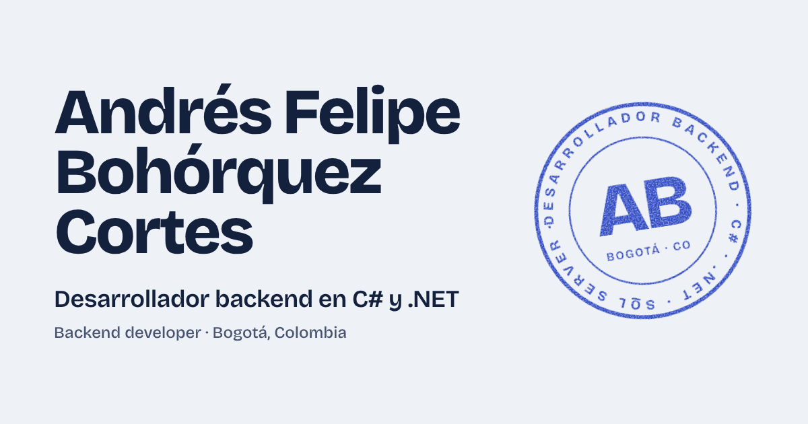

# Portafolio · Andrés Bohórquez

Mi portafolio personal como desarrollador backend en C# y .NET. Reúne mis proyectos, experiencia y formación, en español e inglés.

**🔗 [andres3105.github.io](https://andres3105.github.io)**



## Objetivo

Un portafolio lo abre un reclutador desde LinkedIn, muchas veces en el celular y con datos móviles. Por eso la prioridad fue que cargue al instante en cualquier conexión, sin renunciar a una identidad visual propia. Cada tecnología de abajo se eligió con ese criterio.

## Resultados

Medido con Lighthouse en móvil y escritorio, en las dos versiones de idioma:

| Rendimiento | Accesibilidad | Buenas prácticas | SEO |
|:-:|:-:|:-:|:-:|
| 100 | 100 | 100 | 100 |

- **Unos 40 KB en total** por página (comprimido), incluida la tipografía.
- **0 archivos JavaScript** externos.
- **CLS de 0**: nada se mueve mientras la página carga.

## Tecnologías y por qué las elegí

### Astro
Astro genera HTML estático al compilar y, a diferencia de React o Angular, no envía JavaScript al navegador salvo que se le pida. Así obtengo componentes reutilizables y datos tipados al desarrollar, mientras que el visitante solo descarga HTML y CSS.

### TypeScript para el contenido
Proyectos, experiencia, formación y textos de la interfaz viven en archivos de datos tipados, separados del diseño. El texto en español y en inglés está uno junto al otro, y el tipo de cada texto exige las dos versiones: si falta una traducción, el editor lo marca como error.

### CSS propio, sin Tailwind ni Bootstrap
El sitio tiene una sola página por idioma, así que un framework de CSS habría agregado peso y clases sin aportar mucho. El CSS se escribe a mano con variables para los dos temas, y Astro lo incrusta dentro del HTML. Así el navegador no tiene que hacer una petición extra antes de pintar la página.

### Datos de GitHub leídos durante el build
El lenguaje y la fecha de actualización de cada repositorio salen de la API de GitHub, pero se consultan al compilar y no en el navegador. El visitante no espera ninguna petición, no hay riesgo de chocar con el límite de uso de la API y, si GitHub no responde, el build usa datos de respaldo en lugar de fallar.

### Una sola tipografía, recortada
Usé Bricolage Grotesque en su versión variable: un solo archivo cubre todos los pesos, de regular a extrabold. La recorté con `fonttools` para dejar solo los caracteres latinos que necesito, y pasó de 41 KB a 33 KB. Se precarga junto con el HTML para que el texto aparezca con su fuente desde el primer momento.

### El sello en SVG
El elemento visual central es un sello de tinta, una referencia a la facturación electrónica, donde trabajé validando documentos. Está dibujado en SVG, con un filtro `feTurbulence` que le da la textura de tinta, así que no requiere ninguna imagen. Es la única animación automática de la página.

### Tema claro y oscuro sin parpadeo
El tema sigue la preferencia del sistema operativo y recuerda la elección del visitante. Un script de pocas líneas, incrustado en el `<head>`, lo aplica antes de pintar la página para evitar el destello blanco típico del modo oscuro. Es todo el JavaScript que tiene el sitio.

### Bilingüe con rutas estáticas
Español en `/` e inglés en `/en/`, cada uno como un HTML independiente con etiquetas `hreflang`. Así los buscadores muestran el idioma correcto y no hace falta JavaScript para traducir.

### GitHub Actions y GitHub Pages
Cada push a `main` compila y publica el sitio automáticamente. El workflow también corre una vez por semana, así que las fechas de los repositorios se mantienen al día sin que yo tenga que hacer nada. El hosting es gratuito y está en el mismo lugar que el código.

### Accesibilidad
Enlace para saltar al contenido, foco visible al navegar con teclado, contraste verificado en los dos temas y respeto por `prefers-reduced-motion` para quien desactiva las animaciones.

## Estructura

```
src/
├── components/   Página y sello
├── data/         Contenido bilingüe y datos de contacto
├── layouts/      HTML base, metadatos y tema
├── lib/          Lectura de la API de GitHub
├── pages/        Rutas: /, /en/, 404, sitemap y robots
└── styles/       CSS global
```

## Ejecutar en local

Requiere Node 22 o superior.

```bash
npm install
npm run dev
```

## Contacto

**Andrés Felipe Bohórquez Cortes**, Bogotá, Colombia
[GitHub](https://github.com/Andres3105)
